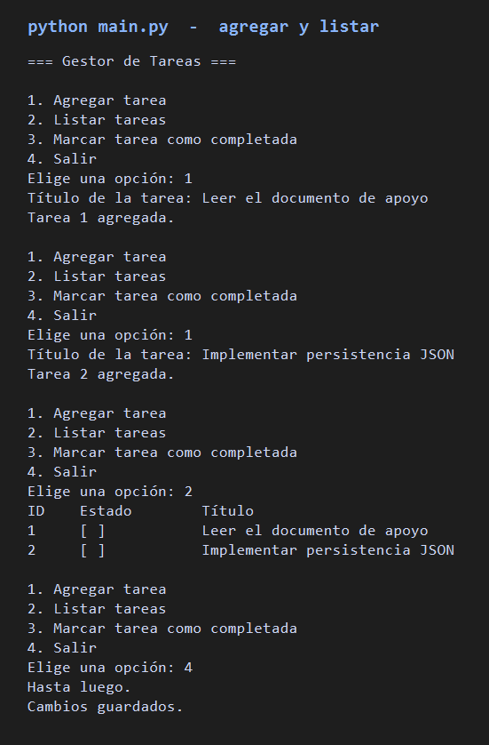
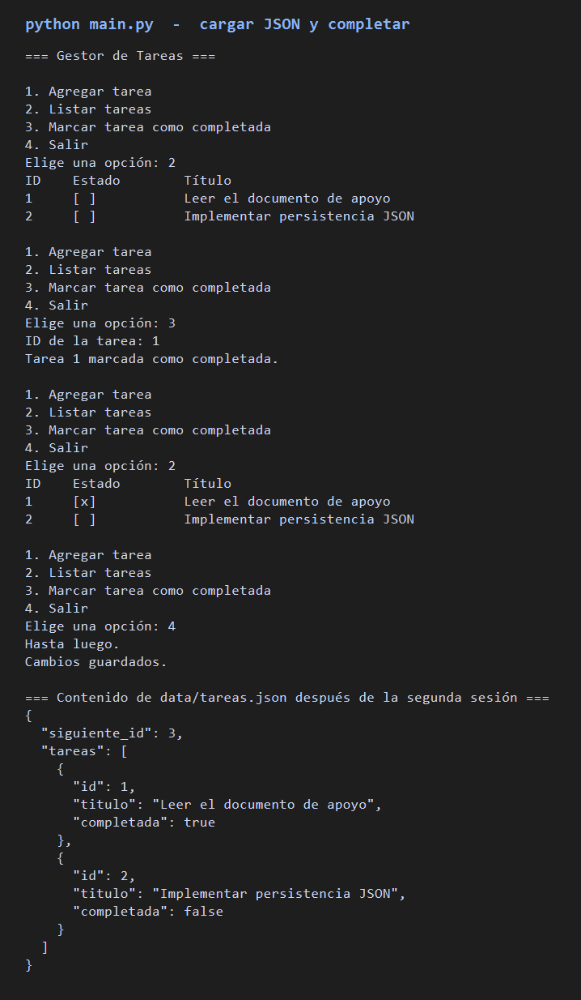
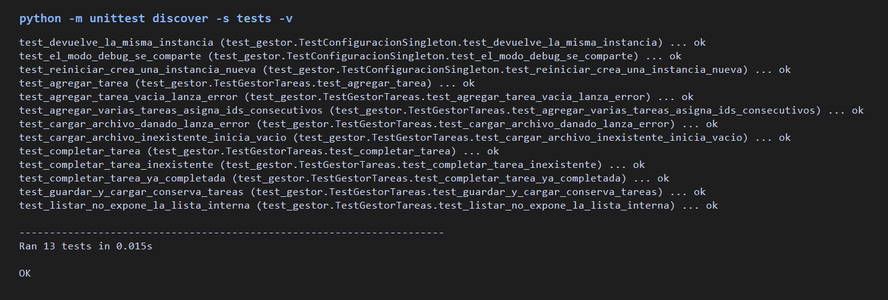

# Gestor de Tareas

Aplicación de consola en Python para administrar tareas pendientes. Forma parte de la Actividad 1 de Seguridad y automatización de redes: cubre el patrón Singleton, control de versiones, pruebas unitarias y persistencia en JSON.

## Funcionalidades

- Agregar nuevas tareas.
- Listar todas las tareas.
- Marcar tareas como completadas.
- Cargar automáticamente las tareas guardadas al iniciar.
- Guardar los cambios en un archivo JSON antes de cerrar.
- Compartir la configuración global (modo debug y ruta del archivo) con el patrón Singleton.

## Requisitos

- Python 3.10 o superior.
- No requiere bibliotecas externas: solo usa la biblioteca estándar.

## Ejecución

Desde la raíz del proyecto:

```bash
python main.py
```

El menú ofrece cuatro opciones:

1. Agregar tarea
2. Listar tareas
3. Marcar tarea como completada
4. Salir

Al salir, la aplicación escribe `data/tareas.json`. Ese archivo no se versiona. La siguiente ejecución lo vuelve a cargar.

Para ver mensajes internos de diagnóstico:

```powershell
$env:GESTOR_DEBUG = "1"
python main.py
```

Valores aceptados: `1`, `true`, `si`, `yes` u `on`.

## Pruebas unitarias

```bash
python -m unittest discover -s tests -v
```

También se puede ejecutar el archivo directamente:

```bash
python tests/test_gestor.py
```

Las pruebas cubren agregar tareas, completarlas (incluidos los casos de id inexistente y tarea ya completada) y la persistencia JSON. La salida de la última ejecución está en [`resultados/pruebas_unitarias.txt`](resultados/pruebas_unitarias.txt). Una sesión de ejemplo, con carga y guardado entre dos ejecuciones, está en [`resultados/ejecucion.txt`](resultados/ejecucion.txt).

Capturas de esa misma salida:







## Estructura

```text
main.py                      Menú de consola
gestor_tareas/
  configuracion.py           Singleton de configuración
  gestor.py                  Alta, listado, completado y JSON
  tarea.py                   Modelo de una tarea
tests/test_gestor.py         Pruebas con unittest
resultados/                  Salida de pruebas y de una ejecución
docs/capturas/               Capturas de la aplicación y de las pruebas
data/tareas.json             Datos locales (se crea al salir)
```

## Configuración global

`Configuracion` implementa el patrón Singleton: `Configuracion.obtener()` y `Configuracion()` devuelven el mismo objeto durante toda la ejecución. Ahí viven el nombre de la aplicación, el modo debug y la ruta del archivo JSON. El gestor de tareas consulta esa única instancia, así que un cambio de configuración aplica a todo el programa.

## Formato del archivo JSON

```json
{
  "siguiente_id": 3,
  "tareas": [
    {
      "id": 1,
      "titulo": "Leer el documento de apoyo",
      "completada": false
    }
  ]
}
```
